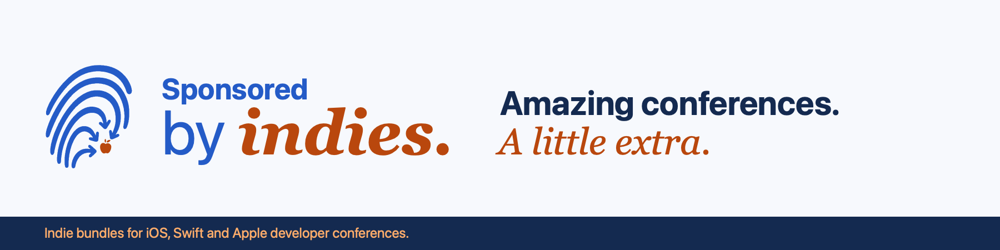

# Sponsored by Indies



Free products and discounts from independent makers, included with tickets to iOS, Swift and Apple developer conferences. Contributions can include apps, games, tools, courses, books and more.

Visit [sponsored.byindies.com](https://sponsored.byindies.com). This repository contains the website’s code, content and artwork.

[By Indies](https://byindies.com) showcases the contributing projects and their builders. Both sites share the Swift components, theme, design tokens, CSS and content in this repository. The showcase’s publishing repository contains generated files only; make every source change here.

## Preview the website

The site uses [Ignite](https://github.com/Ignite-Swift/Ignite), a tool that turns code written in the Swift programming language into website pages.

You’ll need a Mac with Xcode 26.3 or later, which includes Swift, Python 3 for the preview server, and OptiPNG (`brew install optipng`). Install the [Ignite command-line tool](https://github.com/Ignite-Swift/Ignite/tree/0.7.2#getting-started), then run these commands in Terminal:

```sh
git clone https://github.com/dadederk/Sponsored-by-Indies.git
cd Sponsored-by-Indies/Website
ignite build
ignite run --preview
```

The first Ignite command creates the pages; the second opens them in your browser. Press Return in Terminal to stop the preview. After editing, run `ignite build` in another Terminal window and reload the page.

To preview By Indies, generate its pages and serve them on port 8001:

```sh
swift run --package-path Website --force-resolved-versions SponsoredByIndiesWebsite --site showcase
python3 -m http.server 8001 --directory Website/BuildIndies
```

Run these commands from the repository root. Serve `Website/Build` on port 8000 in another terminal to follow links between the two previews.

For content review without another domain or server, open `/by-indies-preview/` on the Sponsored site. It uses the same showcase page and builder cards, with By Indies branding and local navigation. The review route remains available directly while the Sponsored footer links to the showcase domain. This temporary route is public, marked `noindex`, and excluded from the sitemap.

## Make changes

| Folder | What you’ll find |
| --- | --- |
| `Website/Data/` | Conference, maker and offer details |
| `Website/Sources/SponsoredByIndiesWebsite/` | Code for the pages, shared elements and website generation |
| `Website/Assets/` | Styles, logos and code that runs in the browser |
| `Website/Tests/` | Automated checks |
| `assets/brand/` | Brand exports grouped by site, with usage and regeneration notes |
| `assets/social/<conference>/<edition>/partners/` | Approved partner posts |
| `Website/BuildArtwork/` | Local partner previews; ignored by Git |

Keep existing page addresses and add only approved conference and offer details. Each year’s participation and offers need fresh approval.

Conference descriptions stay plain text for metadata. An optional `descriptionLink` adds one inline link to the displayed description, using `text` and `url`. Its text must appear exactly once in the description.

The conference directory features the nearest current or future edition, lists the remaining upcoming editions, and shows past editions newest first. Past starts with two editions; “Show all past conferences” reveals the rest without JavaScript. Empty sections and unnecessary archive controls stay hidden.

`projects.json` holds shared project IDs, names, URLs, icons and descriptions. Changes to these shared fields also appear in past bundles; offer terms, prices and approvals stay specific to each edition. Conference offers reference a `projectID` and contain only edition-specific details. The showcase lists each project with an approved offer and approved participation in at least one edition, once, alphabetically. Past contributors remain visible, and bundle links show the edition’s dates. Each project has a copyable permalink, with a native link and manual-copy fallback. Bundle links use stable project anchors and do not imply an offer is currently redeemable.

`indies.json` holds maker identities and individual `people` rows, with optional bios, personal websites, social links and local portrait paths. Display builder links in this order: Website, Mastodon, Bluesky, Twitter, GitHub, Instagram, LinkedIn, using the available profiles. Public social avatars may be sourced from Twitter, Mastodon, Bluesky or GitHub. Keep the matching profile link in `socials` and download the selected image into `Website/Assets/portraits/`; visitors load the local copy. Missing portraits use initials, and loading fails if a referenced image is missing. The independently curated discovery links live in `site.json` under `discoveryResources`; they do not indicate a partnership.

Builder cards use the same profile across a person's projects. Write a short third-person bio, usually two sentences and 25–40 words: their role or focus, then concrete work or interests. Use their own website and linked profiles as sources. Describe the person rather than repeat the app description; avoid unsupported credentials, promotional claims and filler. Use their preferred name and a current, recognisable portrait. Try their linked X profile first, then their website or another linked public profile; use initials when no suitable image is available. Keep product icons separate from portraits. Each collaborator gets their own profile and links. An optional `creditName` shortens bundle credits without changing the name shown in builder profiles. Keep research notes and unapproved profiles in private planning.

Keep each builder profile to five links at most, including Website. Choose the most relevant verified profiles from the agreed link order.

Use an indie’s optional `disclosure` for a relevant relationship that applies to their projects. It appears beside their maker details in both bundle and showcase cards; keep it factual and specific.

Prefer original square App Store artwork for app icons, at 512 pixels or larger when available. Avoid store thumbnails with baked-in padding or rounded corners; the card applies its own corner radius. If Mac artwork includes extra canvas padding, use the maker’s unpadded press asset at the standard display size. Use the maker’s press kit or website for products without a store listing, and keep images locally. The listed apps use locally stored 512px PNG artwork checked against their App Store listings. Profile photos use a thin, pale border to separate them from the card background.

Read [AGENTS.md](AGENTS.md) for coding conventions and verification guidance.

Bundle cards appear in descending order of potential saving, using US prices in USD as the shared baseline. Each price record identifies the exact store plan, regular price, discount percentage, eligible period, source, observed prices and check date. Savings use decimal arithmetic and round down to cents; both ranking and bundle totals use that same calculation. Alternative offers for one product are not added together. Equal savings use app name, maker ID and product URL for stable ordering.

Bundle totals are generated from the explicitly reviewed compatible offer IDs. Validation rejects duplicate products, missing evidence, a lower-value alternative, invalid percentages, mismatched currency or storefront, and fractional-cent reference prices. The headline rounds the computed total down to whole dollars and shows it as potential value. Each card’s terms show the exact reference price, plan and source. Keep internal price-review notes and contributor follow-ups in private planning; the repository check rejects price-review note fields in conference data. Check dates appear in the bundle’s calculation details. Final checkout prices and eligibility can differ.

Offer terms use one bullet per option, with “Choose one offer” once for alternatives. Show the estimated payment and saving, then the linked regular US price and exact plan. When the maker confirms a specific offer price, record it as `confirmedOfferPriceUSD`; payment uses that amount and savings use the difference from the regular price. Validation requires a valid USD price consistent with the percentage discount within one cent; a 100% discount must have a zero price. Keep the supporting correspondence private. Otherwise the estimated payment is the regular price minus the conservative saving, so the displayed amounts add up; checkout may differ by a cent. Keep additional terms brief and share redemption instructions once when they match. Annual offers return to the regular price at renewal after the first year, unless the offer's `renewalTerms` states an exception. Do not present today's reference price as a guaranteed future renewal price.

For current and upcoming editions, builds reject future-dated evidence and prices checked more than 30 days ago. Historical editions retain their original evidence. Routine builds stay offline. To check the public sources explicitly, run:

```sh
swift run --package-path Website --force-resolved-versions SponsoredByIndiesWebsite --verify-prices
```

This read-only command checks approved offers for current and upcoming editions, leaving archived evidence intact. It compares exact App Store plan labels, or an exact product name in Schema.org JSON-LD offers, and all distinct matching USD prices against the recorded observations. For structured sources, set `sourceFormat` to `schemaOrg` and record `sourceProductName`; App Store sources are the default. Structured checks read the named product’s USD offer, not unrelated promotional text or team prices. Use the regular price applicable to the conference period, rather than an introductory offer that ends before it. Missing or changed prices fail the check; it never picks the first or largest price, changes content, or refreshes dates automatically. Multiple prices under one plan name require an explicitly marked provisional selection. Record the reasoning and any maker-confirmation task in private planning, outside the website repository. Matching a public listing does not confirm which price a particular customer or offer is eligible for; confirm ambiguous plans with the maker. After reviewing a successful check, update the evidence and check date together. Use `--verify-prices` and `--validate-only` separately; validation stays offline.

For an official price page without supported machine-readable offers, use `sourceFormat: "manual"` after reviewing the exact product and USD price. This keeps the same calculation and freshness checks; the live verifier explicitly requests manual review instead of reporting an automatic match.

The separate “Review price evidence” workflow checks dates and live sources daily and on demand. Its summary distinguishes automatic matches, provisional selections, manual sources and failures. Temporary network failures are retried; changed prices still fail. Fresh manual evidence is reported without an automatic match, and stale evidence fails. No check updates content or review dates automatically.

The repository maintainer reviews scheduled price-check failures, confirms ambiguous plans with the maker, and updates the evidence and check date together. Run this offline check for seven days of notice before evidence expires:

```sh
swift run --package-path Website --force-resolved-versions SponsoredByIndiesWebsite --check-maintenance
```

The maintenance check reports provisional selections without treating them as confirmed. Neither it nor the live check updates dates or content. Keep current evidence under review at least every three weeks; archived editions keep their original evidence.

## Build and check

Builds require [OptiPNG](https://optipng.sourceforge.net/) for lossless PNG compression:

```sh
brew install optipng
```

Original icons and portraits stay in `Website/Assets`. Each build generates smaller
copies under `optimized/` for the 64px icon and 56px portrait slots, capped at 3×
their display size without enlarging smaller sources. Product copies are fitted before resizing. Square app icons use their near-opaque
tile bounds, excluding soft outer shadows that make Mac icons appear smaller.
Non-square covers trim only fully transparent outer canvas and retain their
proportions. Translucent artwork without a solid tile uses its visible bounds.
Source masters stay intact, and portraits keep their original framing. Resampled copies use 8-bit
colour with preserved RGB profiles, transparency and aspect ratios. JPEG portraits use high-quality JPEG copies;
WebP inputs use PNG copies. The shared Ignite components select these files and
provide dimensions and asynchronous decoding, while portraits remain lazy-loaded.
OptiPNG then compresses all published PNGs, including sharing artwork and original
fallbacks, without quantisation or stripping colour profiles. No image tools run
in visitors’ browsers. Compressed PNGs are cached by input content under
`Website/.build/optimized-pngs`; changed inputs get fresh results. Both the cache
and generated files stay out of source control.

For the full checks, also install [Node.js 22.12 or later](https://nodejs.org/) to test the code that runs in visitors’ browsers.

Run the following from the main project folder. If you’re still in `Website`, run `cd ..` first:

```sh
swift Scripts/CheckPublicRepository.swift
swift test --package-path Website --force-resolved-versions

swift run --package-path Website --force-resolved-versions SponsoredByIndiesWebsite
swift run --package-path Website --force-resolved-versions SponsoredByIndiesWebsite \
  --public --site-url https://sponsored.byindies.com
swift run --package-path Website --force-resolved-versions SponsoredByIndiesWebsite --site showcase
swift run --package-path Website --force-resolved-versions SponsoredByIndiesWebsite \
  --site showcase --public --site-url https://byindies.com

PUBLIC_SITE_URL=https://sponsored.byindies.com node --test Website/Tests/*.test.mjs

cd Website
npm ci --ignore-scripts
npx playwright install chromium webkit
npm run test:browser
```

These commands check the content, run tests and create preview and public pages for both sites. All four builds are needed for the final checks. The Swift commands let us include each website’s address when creating the public pages. The showcase validates content but does not require fresh price evidence, because it publishes no prices or savings.

Browser checks use Chromium and WebKit at desktop and narrow mobile widths. They cover navigation, dialog focus, form validation, repeatable contributions, email-file attachments, script-failure fallbacks and automated accessibility checks. The browser packages are development dependencies; they add nothing to the published site. Failures produce a local HTML report in `Website/playwright-report`, also saved by GitHub for seven days.

Generated pages go into `Website/Build` and `Website/BuildPublic`. GitHub runs these checks automatically and publishes the website when changes reach `main`, the project’s main branch. It also rebuilds daily at 05:37 UTC to refresh date-dependent pages, and checks live prices and approaching evidence expiry independently. Failed publication leaves the last deployed website intact. Check scheduled runs in GitHub Actions; scheduling can be delayed, and GitHub may disable schedules in inactive repositories.

By Indies outputs go into `Website/BuildIndies` and `Website/BuildIndiesPublic`, with their own canonical URLs, sitemap and sharing artwork. CI saves the public showcase as the `by-indies-public` artifact. Both publications must pass the build checks before either publishing job runs.

Generated artwork uses the same folder structure in every site build and in the repository’s ready-to-share exports:

| Folder within a build | Contents |
| --- | --- |
| `assets/brand/shared/` | Resolved vector marks shared by both sites |
| `assets/brand/sponsored-by-indies/` or `assets/brand/by-indies/` | Site sharing card (1200 × 630), banner (1500 × 500), avatar (1024 × 1024), README banner (1800 × 450), and available transparent logos |
| `assets/social/<conference>/<edition>/` | Conference bundle sharing cards |
| `assets/icons/` | SVG and PNG browser icons |
| `css/` | Generated design tokens and Ignite stylesheets |
| `optimized/app-icons/` and `optimized/portraits/` | Delivery images sized for cards |

Asset folder names use lowercase words separated by hyphens and stable slugs, such as `sponsored-by-indies`, `arctic` and `2027`. Use the same `assets/brand/<site>/` and `assets/social/<conference>/<edition>/` hierarchy beneath every output root, with `partners/` and `constellations/` for promotional types. Local partner previews add a partner folder beneath `partners/` to keep their variants together. Existing Swift source folders and build-root names retain their project conventions.

Artwork filenames use lowercase words separated by hyphens and include their site or conference, edition and purpose, for example `by-indies-social-banner.png` and `arctic-2027-dee-cross.png`. The conventional `favicon.ico` and `apple-touch-icon.png` stay at the site root for automatic browser discovery. Original product images and portraits retain their stable data paths.

Both sites use the shared “by indies.” wordmark, with “Sponsored” above it for the conference site. The showcase’s generated repository README uses its own banner. After changing branding, regenerate both sites and refresh the exports following [the artwork instructions](assets/brand/README.md); the source README uses the Sponsored banner directly from that folder. Website builds do not overwrite the committed exports.

Each bundle also generates a 1200 × 630 sharing card in `assets/social/<conference>/<edition>/`, using the conference’s JSON palette, name, edition, dates and location. Edition pages, their conference-home mirror and access pages share that card. Its filename changes when those details change, while renderer and logo changes update the asset version. Other pages keep their site’s general sharing card.

### Book series artwork

Use the original portrait cover files to make a consistent series montage. Keep source masters and an ordered JSON manifest together; keep unapproved books and their artwork in private planning. The offline renderer preserves cover text and proportions, uses fixed positions and a transparent sRGB canvas, and adds no generated lettering or timestamps.

```json
{
  "layout": "staggered-v1",
  "covers": [
    { "file": "covers/first.png", "title": "First book" },
    { "file": "covers/second.png", "title": "Second book" }
  ]
}
```

```sh
swift Scripts/MakeBookMontage.swift /path/to/series.json /path/to/series.png
```

Paths are relative to the manifest. List two to five covers from back to front, with the most recognisable covers last. The renderer applies image orientation before checking the portrait shape and rejects output paths that refer to a source cover or the manifest. `staggered-v1` exports a 1240 × 1500 transparent PNG using fixed layouts for each cover count. The same inputs produce the same pixels on the same rendering platform. Retain the manifest and source files for later updates; introduce a new layout version if the composition rules change. Use the result as the product's local artwork and follow the usual card and promotional checks.

### Promotional artwork

Keep three kinds of promotional graphics for each conference edition:

1. One conference × Sponsored by Indies card.
2. One conference × project card for each approved project, combining related projects from the same maker only when the grouping is deliberate. A different product category can keep its own card: RocketSim and RocketTrace share a post, while AI Fundamentals stays separate; Azam’s two books share a post.
3. Constellation cards with projects surrounding the conference logo, created when enough newly approved projects fill the established layout. Near the conference, publish a final partial batch so projects not featured in previous rounds still get visibility. Keep completed constellations unchanged and queue later projects for the next one.

Membership and order are explicit, rather than inferred from maker identity or the current price ranking. Each export includes `artwork-index.json`, listing the edition, dimensions, project IDs and filenames. It contains no timestamps or machine-specific paths, so unchanged inputs produce the same index. The partner series always lists the sponsor first, then partner IDs alphabetically; paired products retain the order in the edition data.

#### Create partner posts

Generate matching 1800 × 1200 PNGs with a cross or a heart between the conference and partner logos:

```sh
swift run --package-path Website --force-resolved-versions SponsoredByIndiesWebsite --partner-artwork arctic-2027
swift run --package-path Website --force-resolved-versions SponsoredByIndiesWebsite --partner-artwork arctic-2027 --project dee
swift run --package-path Website --force-resolved-versions SponsoredByIndiesWebsite --partner-artwork arctic-2027 --group rocketsim-rockettrace
swift run --package-path Website --force-resolved-versions SponsoredByIndiesWebsite --partner-artwork arctic-2027 --all-partners
```

The first command pairs the conference with Sponsored by Indies. Add `--project` to select an approved product from that edition; product posts also carry the small Sponsored by Indies signature. Each command writes `<conference>-<edition>-<partner>-cross.png` and `…-heart.png` under `Website/BuildArtwork/assets/social/<conference>/<edition>/partners/<partner>/`, preserving previous exports if rendering fails. These graphics are local exports and are not deployed with the website.

Use `--group` for two products sharing a post. Define the group ID and ordered `projectIDs` in the edition’s `artworkGroups`; validation requires two distinct approved products from the same maker with local artwork and prevents a product from appearing in multiple groups. Paired products sit side by side, and portrait book artwork keeps its original proportions and square corners.

Use `--all-partners` to export the final navy-X series to `assets/social/<conference>/<edition>/partners/`. The set includes Sponsored by Indies and every approved product exactly once, combining the edition’s groups. It replaces only the `partners` folder after every render succeeds, removing stale individual posts when products are grouped while preserving other edition artwork. These ready-to-share PNGs can be committed alongside the brand exports.

Include artwork in the contribution approval process: generate the new product’s `--project` or configured `--group` export, visually check it, and refresh the edition with `--all-partners`. Keep unconfirmed examples and their exports in private planning.

For constellation posts, follow the approved reference: projects surround the conference logo, and projects providing larger discounts have larger imagery. Use explicit positions, sizes and ordering; never introduce random placement. Agree the discount metric and sizing rule before automating the renderer, then freeze each completed batch so later price or discount changes do not alter an already published graphic.

Keep a private record of each completed graphic’s path, layout capacity, ordered product IDs, positions and sizes. Queue newly approved products that have not appeared in an earlier constellation. Generate and publish the next graphic when the queue fills that layout. Near the conference, publish a final batch even if it has unfilled slots, giving the remaining projects visibility. Record generation and publication separately and clear only the featured projects from the queue. Preserve earlier graphics rather than reshuffling them whenever one product joins. Final files belong in `assets/social/<conference>/<edition>/constellations/`, named `<conference>-<edition>-constellation-01.png`, `…-02.png`, and so on. Do not reconstruct an earlier graphic’s membership or capacity from guesses; verify its original first. The partner renderer does not automatically create or replace constellations.

The renderer uses fixed geometry and the shared palette and dimensions in `DesignTokens.swift`. It draws original product icons, the approved brand PNG and outlined conference SVGs without generated lettering or platform emoji. Repeating a render with the same inputs and rendering runtime produces identical PNG bytes. Conference SVG paths live in `Website/Assets/conference-logos/` and are selected by `branding.logoPath` in the conference JSON; their paints resolve from that conference’s palette. ARCtic’s outlines match its original Roboto Mono lettering and need no installed fonts.

The `publish-showcase` job requires the Actions variable `BY_INDIES_PUBLISH_ENABLED` to be `true`. Enable it to publish the showcase to its separate repository. The Sponsored footer links to `https://byindies.com/`; the non-indexable review route stays available for checking content on the Sponsored site.

Swift publishing tests also generate an ignored `.build/browser-fixtures/conference-directory.html` sample with past editions. Run them before the browser checks, which use it to verify keyboard expansion, collapse and no-script behaviour without adding sample conferences to the public catalogue.

## Configure By Indies hosting

The setup helper creates the publication repository, configures Pages and its custom domain, and sets the source repository’s publishing variable. It checks for an existing publishing secret and explains how to add one when missing. It does not commit or push source changes, or change DNS.

From the repository root, preview its actions, then apply them:

```sh
swift Scripts/SetupByIndiesHosting.swift --dry-run
swift Scripts/SetupByIndiesHosting.swift --apply
```

You’ll need the [GitHub CLI](https://cli.github.com/) signed in as an administrator of this source repository (`gh auth login`). If the publishing secret is missing, create a fine-grained token for the new publication repository, with **Contents: read and write**. Run `gh secret set BY_INDIES_PAGES_TOKEN --repo dadederk/Sponsored-by-Indies` directly in your Terminal and paste the token at that prompt, then rerun setup. The helper leaves token entry to the CLI rather than nesting its terminal prompt inside Swift.

Setup reports each stage and stops commands that take longer than 60 seconds. Use `--timeout 120` to allow a slower connection. After setting DNS and allowing the certificate to become ready, run `swift Scripts/SetupByIndiesHosting.swift --enable-https` to enforce HTTPS. Rerunning setup preserves an existing secret and reuses the publication repository; it stops if that repository contains another project.

The generated repository includes a By Indies README with the shared artwork, a short introduction, source and participation links, and credits. Its documentation is regenerated with each publication, alongside the website.

For manual setup, follow these steps:

Keep this repository’s GitHub Pages custom domain set to `sponsored.byindies.com`. GitHub Pages serves one site per repository, so use a separate output-only repository for `byindies.com`:

1. Create a public repository, for example `dadederk/By-Indies-Pages`, with an initial `main` branch and only a README headed `# By-Indies-Pages` (matching the repository name). Its contents will be replaced by generated files. Publication refuses unrelated files, README content or a different custom domain.
2. Create a fine-grained personal access token restricted to that repository, with **Contents: read and write**. Add it to this source repository’s Actions secrets as `BY_INDIES_PAGES_TOKEN`.
3. Set this source repository’s Actions variable `BY_INDIES_PAGES_REPOSITORY` to the destination’s `owner/repository` name. The optional publishing job copies the checked output there and removes stale files.
4. When the content is ready to launch, set the Actions variable `BY_INDIES_PUBLISH_ENABLED` to `true` and run the publishing workflow. In the destination repository’s Pages settings, select **Deploy from a branch**, `main`, `/ (root)`, and set its custom domain to `byindies.com` before changing DNS.
5. At your DNS provider, set the apex (`@`) `A` records to `185.199.108.153`, `185.199.109.153`, `185.199.110.153` and `185.199.111.153`, or use an `ALIAS`/`ANAME` to `dadederk.github.io` if supported. Keep `sponsored` as a `CNAME` to `dadederk.github.io`; GitHub uses each repository’s domain setting to select the site. An optional `www` `CNAME` to `dadederk.github.io` redirects to the apex when configured in Pages.
6. Enable **Enforce HTTPS** once the certificate is ready. Verify both homepages, their reciprocal links, a project-to-bundle anchor and the canonical URLs on the live domains.

See GitHub’s [custom domain setup](https://docs.github.com/en/pages/configuring-a-custom-domain-for-your-github-pages-site/managing-a-custom-domain-for-your-github-pages-site) and [domain verification](https://docs.github.com/en/pages/configuring-a-custom-domain-for-your-github-pages-site/verifying-your-custom-domain-for-github-pages) instructions. Local generation does not change hosting or DNS.

Before releasing a changed interaction, also check VoiceOver in Safari, keyboard navigation, zoom and larger text. Open both a text-only draft and an image-bearing `.eml` file in the supported email apps, check the recipient, text and attachments, and discard the drafts. Automated checks do not verify screen-reader announcements or email-app behaviour.

## Get involved

[Report a problem or suggest an improvement](https://github.com/dadederk/Sponsored-by-Indies/issues). Changes to the code are welcome too.

To contribute a product or discuss a conference, use the website’s [participation pages](https://sponsored.byindies.com/participate/).

## Credits

Coordinated by [Dani Devesa Derksen-Staats](https://github.com/dadederk), who also writes [Accessibility up to 11](https://accessibilityupto11.com).

Built with [Ignite](https://github.com/Ignite-Swift/Ignite), created by [Paul Hudson](https://github.com/twostraws) and developed with the Ignite community. This project uses version 0.7.2, available under the [MIT license](https://github.com/Ignite-Swift/Ignite/blob/0.7.2/LICENSE).

Thanks to the independent makers, conference organisers and accessibility community for their contributions and feedback.
