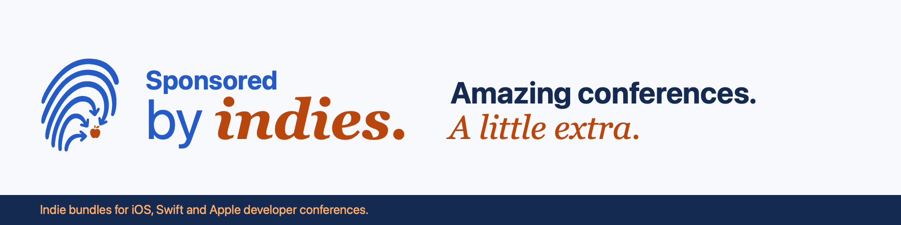

# Sponsored by Indies



Free products and discounts from independent makers, included with tickets to iOS, Swift and Apple developer conferences. Contributions can include apps, games, tools, courses, books and more.

Visit [sponsored.byindies.com](https://sponsored.byindies.com). This repository contains the website’s code, content and artwork.

[By Indies](https://byindies.com) showcases the contributing projects and their builders. Both sites share the Swift components, theme, design tokens, CSS and content in this repository. The showcase’s publishing repository contains generated files only; make every source change here.

## Preview the website

The site uses [Ignite](https://github.com/Ignite-Swift/Ignite), a tool that turns code written in the Swift programming language into website pages.

You’ll need a Mac with Xcode 26.3 or later, which includes Swift, and Python 3 for the preview server. Install the [Ignite command-line tool](https://github.com/Ignite-Swift/Ignite/tree/0.7.2#getting-started), then run these commands in Terminal:

```sh
git clone https://github.com/dadederk/Sponsored-by-Indies.git
cd Sponsored-by-Indies/Website
ignite build
ignite run --preview
```

The first Ignite command creates the pages; the second opens them in your browser. Press Return in Terminal to stop the preview. After editing, run `ignite build` in another Terminal window and reload the page.

To preview By Indies, generate its pages and serve them on port 8001:

```sh
swift run --package-path Website --force-resolved-versions SponsoredByIndiesWebsite --site showcase
python3 -m http.server 8001 --directory Website/BuildIndies
```

Run these commands from the repository root. Serve `Website/Build` on port 8000 in another terminal to follow links between the two previews.

For content review without another domain or server, open `/by-indies-preview/` on the Sponsored site. It uses the same showcase page and builder cards, with By Indies branding and local navigation. The review route remains available directly while the Sponsored footer links to the showcase domain. This temporary route is public, marked `noindex`, and excluded from the sitemap.

## Make changes

| Folder | What you’ll find |
| --- | --- |
| `Website/Data/` | Conference, maker and offer details |
| `Website/Sources/SponsoredByIndiesWebsite/` | Code for the pages, shared elements and website generation |
| `Website/Assets/` | Styles, logos and code that runs in the browser |
| `Website/Tests/` | Automated checks |

Keep existing page addresses and add only approved conference and offer details. Each year’s participation and offers need fresh approval.

`projects.json` holds shared project IDs, names, URLs, icons and descriptions. Changes to these shared fields also appear in past bundles; offer terms, prices and approvals stay specific to each edition. Conference offers reference a `projectID` and contain only edition-specific details. The showcase lists each project with an approved offer and approved participation in at least one edition, once, alphabetically. Past contributors remain visible, with past conferences labelled. Bundle links use stable project anchors and do not imply an offer is currently redeemable.

`indies.json` holds maker identities and individual `people` rows, with optional bios, personal websites, social links and local portrait paths. Display builder links in this order: Website, Mastodon, Bluesky, Twitter, GitHub, using the available profiles. Public social avatars may be sourced from Twitter, Mastodon, Bluesky or GitHub. Keep the matching profile link in `socials` and download the selected image into `Website/Assets/portraits/`; visitors load the local copy. Missing portraits use initials, and loading fails if a referenced image is missing. The independently curated discovery links live in `site.json` under `discoveryResources`; they do not indicate a partnership.

Read [AGENTS.md](AGENTS.md) for coding conventions and verification guidance.

Bundle cards appear in descending order of potential saving, using US prices in USD as the shared baseline. Each price record identifies the exact store plan, regular price, discount percentage, eligible period, source, observed prices and check date. Savings use decimal arithmetic and round down to cents; both ranking and bundle totals use that same calculation. Alternative offers for one product are not added together. Equal savings use app name, maker ID and product URL for stable ordering.

Bundle totals are generated from the explicitly reviewed compatible offer IDs. Validation rejects duplicate products, missing evidence, a lower-value alternative, invalid percentages, mismatched currency or storefront, and fractional-cent reference prices. The headline rounds the computed total down to whole dollars and shows it as potential value. Each card’s terms show the exact reference price, plan and source. Keep internal price-review notes and contributor follow-ups in private planning; the repository check rejects price-review note fields in conference data. Check dates appear in the bundle’s calculation details. Final checkout prices and eligibility can differ.

For current and upcoming editions, builds reject future-dated evidence and prices checked more than 30 days ago. Historical editions retain their original evidence. Routine builds stay offline. To check the public sources explicitly, run:

```sh
swift run --package-path Website --force-resolved-versions SponsoredByIndiesWebsite --verify-prices
```

This read-only command checks approved offers for current and upcoming editions, leaving archived evidence intact. It compares exact App Store plan labels, or an exact product name in Schema.org JSON-LD offers, and all distinct matching USD prices against the recorded observations. For structured sources, set `sourceFormat` to `schemaOrg` and record `sourceProductName`; App Store sources are the default. Structured checks read the named product’s USD offer, not unrelated promotional text or team prices. Use the regular price applicable to the conference period, rather than an introductory offer that ends before it. Missing or changed prices fail the check; it never picks the first or largest price, changes content, or refreshes dates automatically. Multiple prices under one plan name require an explicitly marked provisional selection. Record the reasoning and any maker-confirmation task in private planning, outside the website repository. Matching a public listing does not confirm which price a particular customer or offer is eligible for; confirm ambiguous plans with the maker. After reviewing a successful check, update the evidence and check date together. Use `--verify-prices` and `--validate-only` separately; validation stays offline.

The repository maintainer reviews scheduled price-check failures, confirms ambiguous plans with the maker, and updates the evidence and check date together. Run this offline check for seven days of notice before evidence expires:

```sh
swift run --package-path Website --force-resolved-versions SponsoredByIndiesWebsite --check-maintenance
```

The maintenance check reports provisional selections without treating them as confirmed. Neither it nor the live check updates dates or content. Keep current evidence under review at least every three weeks; archived editions keep their original evidence.

## Build and check

For the full checks, also install [Node.js 22.12 or later](https://nodejs.org/) to test the code that runs in visitors’ browsers.

Run the following from the main project folder. If you’re still in `Website`, run `cd ..` first:

```sh
swift Scripts/CheckPublicRepository.swift
swift test --package-path Website --force-resolved-versions

swift run --package-path Website --force-resolved-versions SponsoredByIndiesWebsite
swift run --package-path Website --force-resolved-versions SponsoredByIndiesWebsite \
  --public --site-url https://sponsored.byindies.com
swift run --package-path Website --force-resolved-versions SponsoredByIndiesWebsite --site showcase
swift run --package-path Website --force-resolved-versions SponsoredByIndiesWebsite \
  --site showcase --public --site-url https://byindies.com

PUBLIC_SITE_URL=https://sponsored.byindies.com node --test Website/Tests/*.test.mjs

cd Website
npm ci --ignore-scripts
npx playwright install chromium webkit
npm run test:browser
```

These commands check the content, run tests and create preview and public pages for both sites. All four builds are needed for the final checks. The Swift commands let us include each website’s address when creating the public pages. The showcase validates content but does not require fresh price evidence, because it publishes no prices or savings.

Browser checks use Chromium and WebKit at desktop and narrow mobile widths. They cover navigation, dialog focus, form validation, repeatable contributions, email-file attachments, script-failure fallbacks and automated accessibility checks. The browser packages are development dependencies; they add nothing to the published site. Failures produce a local HTML report in `Website/playwright-report`, also saved by GitHub for seven days.

Generated pages go into `Website/Build` and `Website/BuildPublic`. GitHub runs these checks automatically and publishes the website when changes reach `main`, the project’s main branch. It also rebuilds daily at 05:37 UTC to refresh date-dependent pages, and checks live prices and approaching evidence expiry independently. Failed publication leaves the last deployed website intact. Check scheduled runs in GitHub Actions; scheduling can be delayed, and GitHub may disable schedules in inactive repositories.

By Indies outputs go into `Website/BuildIndies` and `Website/BuildIndiesPublic`, with their own canonical URLs, sitemap and sharing artwork. CI saves the public showcase as the `by-indies-public` artifact. Both publications must pass the build checks before either publishing job runs.

Each site generates `social-preview.png` (1200 × 630), `social-banner.png` (1500 × 500), `social-avatar.png` (1024 × 1024), `readme-banner.png` (1800 × 450), and browser icons in its build folder. Both use the shared “by indies.” wordmark, with “Sponsored” above it for the conference site. The showcase’s generated repository README uses its own banner. After changing the branding, regenerate both sites and refresh `Images/readme-banner.png` from the Sponsored preview build.

Each bundle also generates a 1200 × 630 sharing card in its edition folder, using the conference’s JSON palette, name, edition, dates and location. Edition pages, their conference-home mirror and access pages share that card. Its filename changes when those details change, while renderer and logo changes update the asset version. Other pages keep their site’s general sharing card.

The `publish-showcase` job requires the Actions variable `BY_INDIES_PUBLISH_ENABLED` to be `true`. Enable it to publish the showcase to its separate repository. The Sponsored footer links to `https://byindies.com/`; the non-indexable review route stays available for checking content on the Sponsored site.

## Configure By Indies hosting

The setup helper creates the publication repository, configures Pages and its custom domain, and sets the source repository’s publishing variable. It checks for an existing publishing secret and explains how to add one when missing. It does not commit or push source changes, or change DNS.

From the repository root, preview its actions, then apply them:

```sh
swift Scripts/SetupByIndiesHosting.swift --dry-run
swift Scripts/SetupByIndiesHosting.swift --apply
```

You’ll need the [GitHub CLI](https://cli.github.com/) signed in as an administrator of this source repository (`gh auth login`). If the publishing secret is missing, create a fine-grained token for the new publication repository, with **Contents: read and write**. Run `gh secret set BY_INDIES_PAGES_TOKEN --repo dadederk/Sponsored-by-Indies` directly in your Terminal and paste the token at that prompt, then rerun setup. The helper leaves token entry to the CLI rather than nesting its terminal prompt inside Swift.

Setup reports each stage and stops commands that take longer than 60 seconds. Use `--timeout 120` to allow a slower connection. After setting DNS and allowing the certificate to become ready, run `swift Scripts/SetupByIndiesHosting.swift --enable-https` to enforce HTTPS. Rerunning setup preserves an existing secret and reuses the publication repository; it stops if that repository contains another project.

The generated repository includes a By Indies README with the shared artwork, a short introduction, source and participation links, and credits. Its documentation is regenerated with each publication, alongside the website.

For manual setup, follow these steps:

Keep this repository’s GitHub Pages custom domain set to `sponsored.byindies.com`. GitHub Pages serves one site per repository, so use a separate output-only repository for `byindies.com`:

1. Create a public repository, for example `dadederk/By-Indies-Pages`, with an initial `main` branch and only a README headed `# By-Indies-Pages` (matching the repository name). Its contents will be replaced by generated files. Publication refuses unrelated files, README content or a different custom domain.
2. Create a fine-grained personal access token restricted to that repository, with **Contents: read and write**. Add it to this source repository’s Actions secrets as `BY_INDIES_PAGES_TOKEN`.
3. Set this source repository’s Actions variable `BY_INDIES_PAGES_REPOSITORY` to the destination’s `owner/repository` name. The optional publishing job copies the checked output there and removes stale files.
4. When the content is ready to launch, set the Actions variable `BY_INDIES_PUBLISH_ENABLED` to `true` and run the publishing workflow. In the destination repository’s Pages settings, select **Deploy from a branch**, `main`, `/ (root)`, and set its custom domain to `byindies.com` before changing DNS.
5. At your DNS provider, set the apex (`@`) `A` records to `185.199.108.153`, `185.199.109.153`, `185.199.110.153` and `185.199.111.153`, or use an `ALIAS`/`ANAME` to `dadederk.github.io` if supported. Keep `sponsored` as a `CNAME` to `dadederk.github.io`; GitHub uses each repository’s domain setting to select the site. An optional `www` `CNAME` to `dadederk.github.io` redirects to the apex when configured in Pages.
6. Enable **Enforce HTTPS** once the certificate is ready. Verify both homepages, their reciprocal links, a project-to-bundle anchor and the canonical URLs on the live domains.

See GitHub’s [custom domain setup](https://docs.github.com/en/pages/configuring-a-custom-domain-for-your-github-pages-site/managing-a-custom-domain-for-your-github-pages-site) and [domain verification](https://docs.github.com/en/pages/configuring-a-custom-domain-for-your-github-pages-site/verifying-your-custom-domain-for-github-pages) instructions. Local generation does not change hosting or DNS.

Before releasing a changed interaction, also check VoiceOver in Safari, keyboard navigation, zoom and larger text. Open both a text-only draft and an image-bearing `.eml` file in the supported email apps, check the recipient, text and attachments, and discard the drafts. Automated checks do not verify screen-reader announcements or email-app behaviour.

## Get involved

[Report a problem or suggest an improvement](https://github.com/dadederk/Sponsored-by-Indies/issues). Changes to the code are welcome too.

To contribute a product or discuss a conference, use the website’s [participation pages](https://sponsored.byindies.com/participate/).

## Credits

Coordinated by [Dani Devesa Derksen-Staats](https://github.com/dadederk), who also writes [Accessibility up to 11](https://accessibilityupto11.com).

Built with [Ignite](https://github.com/Ignite-Swift/Ignite), created by [Paul Hudson](https://github.com/twostraws) and developed with the Ignite community. This project uses version 0.7.2, available under the [MIT license](https://github.com/Ignite-Swift/Ignite/blob/0.7.2/LICENSE).

Thanks to the independent makers, conference organisers and accessibility community for their contributions and feedback.
